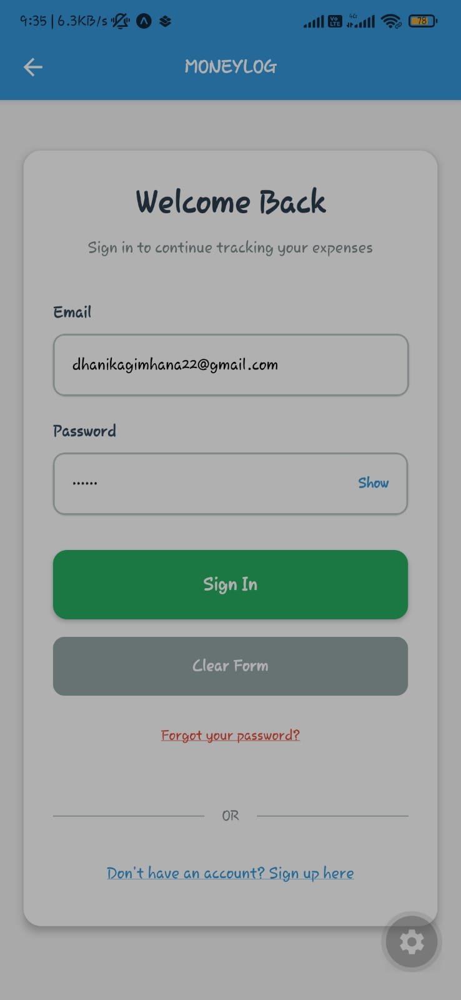
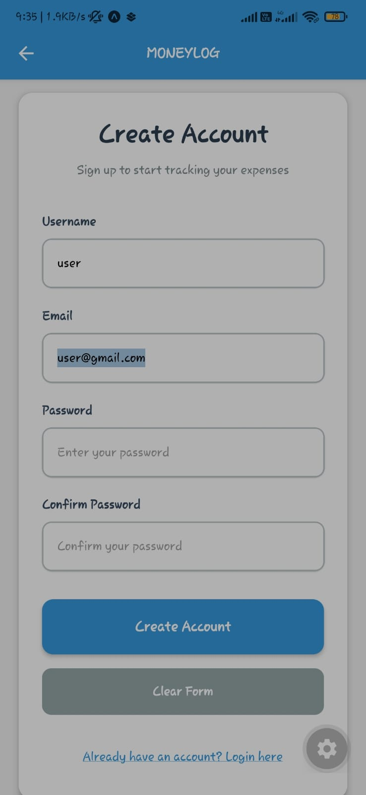
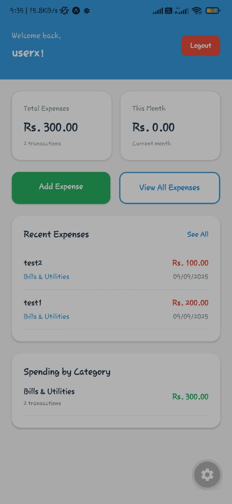
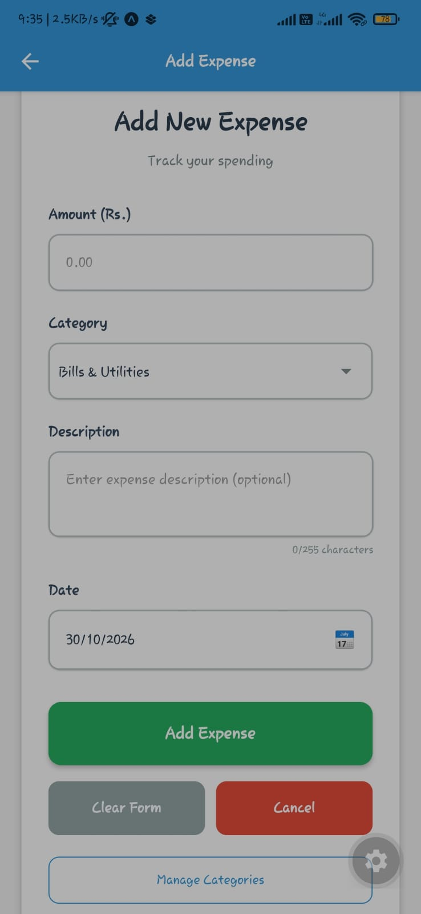
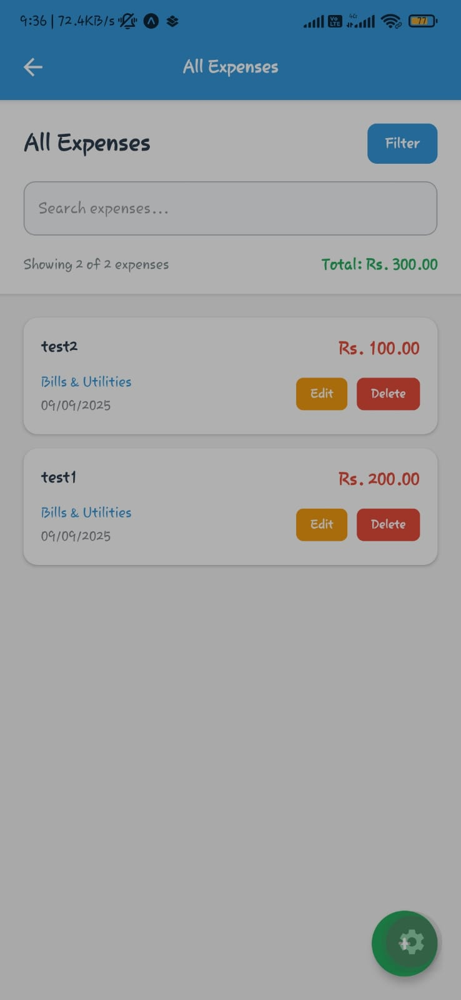
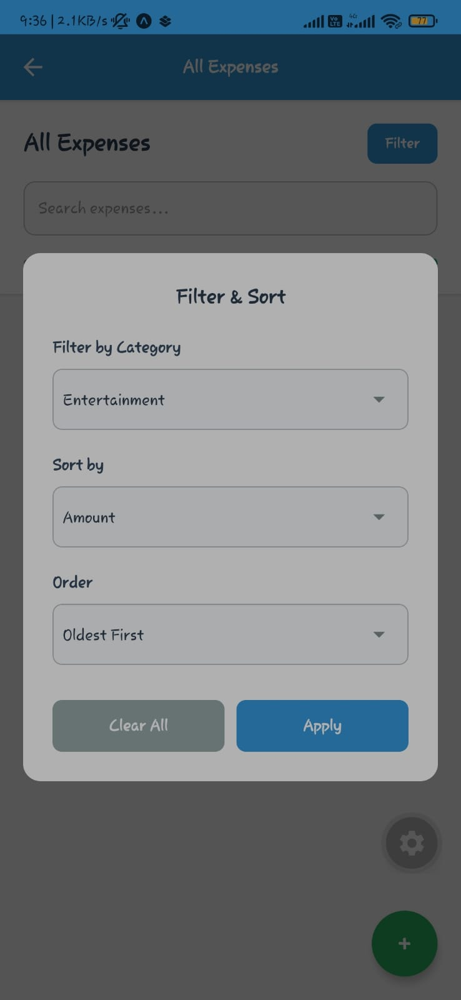

# MoneyLog

**MoneyLog** is a cross-platform personal finance management system consisting of a React Native mobile frontend and a dedicated backend service. It enables users to record income and expenses, organize transactions, and monitor financial activity through a secure client–server architecture.

[](https://opensource.org/licenses/MIT)
[](https://reactnative.dev/)
[](https://nodejs.org/)
[](https://developer.mozilla.org/en-US/docs/Web/HTML)
[](https://developer.mozilla.org/en-US/docs/Web/CSS)

## Repository Organization

MoneyLog is developed as a cross-origin, full-stack application split into two repositories:

| Repository | Role | Link |
|---|---|---|
| **MoneyLog** | React Native mobile frontend | [DhanikaJ/MoneyLog](https://github.com/DhanikaJ/MoneyLog) |
| **MoneyLog-Backend** | Backend API and business logic | [DhanikaJ/MoneyLog-Backend](https://github.com/DhanikaJ/MoneyLog-Backend) |

The frontend communicates with the backend through HTTP APIs. This separation allows the mobile client and server-side services to be developed, tested, deployed, and scaled independently.

## Overview

MoneyLog helps users manage personal finances by providing a structured record of income, expenses, and account activity. The React Native frontend delivers a mobile-first user experience, while the backend handles authentication, data validation, business rules, and persistent storage.

The system follows a client–server architecture in which the frontend sends requests to backend endpoints and receives structured responses. This design supports maintainability, reusability, and future expansion to additional clients such as web or desktop applications.

## Features

### Core Features

- User registration and authentication
- Secure API-based communication between frontend and backend
- Income and expense tracking
- Transaction categorization
- Financial record management
- Account balance and activity monitoring
- Cross-platform mobile interface built with React Native

### Backend Responsibilities

- Expose RESTful API endpoints
- Process and validate client requests
- Manage authentication and authorization
- Apply financial business rules
- Store and retrieve application data
- Return consistent JSON responses

### Frontend Responsibilities

- Provide a responsive React Native user interface
- Collect and validate user input
- Communicate with backend API endpoints
- Display financial records and summaries
- Manage navigation and application state

## System Architecture

```text
React Native Mobile Application
              │
              ▼
       HTTP / REST API
              │
              ▼
MoneyLog Backend Service
              │
              ├── Authentication Layer
              ├── Business Logic Layer
              ├── Data Access Layer
              └── Database
```

## Screenshots

Screenshots are stored in the frontend repository under `/assets/img/`.

| Login Screen | Registration Screen | Dashboard |
|---|---|---|
|  |  |  |
| Add Transaction | Transaction History | Filters |
|  | |  |

## Technology Stack

| Layer | Technology |
|---|---|
| Mobile frontend | React Native |
| Programming language | JavaScript / TypeScript |
| Backend | Node.js |
| API style | RESTful JSON API |
| Database | Relational or NoSQL database, depending on backend configuration |
| Authentication | Token-based authentication |
| Version control | Git and GitHub |
| License | MIT License |

## API Overview

The backend exposes endpoints for authentication and financial-data management. Typical API operations include:

| Method | Endpoint Example | Description |
|---|---|---|
| `POST` | `/api/auth/register` | Register a new user |
| `POST` | `/api/auth/login` | Authenticate a user and issue an access token |
| `GET` | `/api/transactions` | Retrieve user transactions |
| `POST` | `/api/transactions` | Create a new income or expense record |
| `PUT` | `/api/transactions/:id` | Update an existing transaction |
| `DELETE` | `/api/transactions/:id` | Delete a transaction |
| `GET` | `/api/summary` | Retrieve financial summary data |

> Adjust endpoint paths to match the actual backend route definitions.

## Backend Setup

### Prerequisites

- Node.js 18 or later
- npm or yarn
- A configured database
- Git

### Installation

```bash
git clone [https://github.com/DhanikaJ/MoneyLog-Backend.git](https://github.com/DhanikaJ/MoneyLog-Backend.git)
cd MoneyLog-Backend
npm install
```

### Environment Configuration

Create a `.env` file in the backend root directory:

```env
PORT=5000
DATABASE_URL=your_database_connection_string
JWT_SECRET=your_secure_jwt_secret
CORS_ORIGIN=http://localhost:8081
```

> Never commit real database credentials, JWT secrets, or API keys to version control.

### Start the Backend

```bash
npm start
```

For development with automatic restarts:

```bash
npm run dev
```

The backend should now be available at:

```text
http://localhost:5000
```

## Frontend Setup

### Prerequisites

- Node.js 18 or later
- npm or yarn
- Android Studio for Android emulation
- Xcode and CocoaPods for iOS development on macOS
- A physical device or emulator

### Installation

```bash
git clone [https://github.com/DhanikaJ/MoneyLog.git](https://github.com/DhanikaJ/MoneyLog.git)
cd MoneyLog
npm install
```

### Configure Backend URL

Update the frontend API base URL to point to the running backend:

```env
API_BASE_URL=http://localhost:5000
```

For a physical Android device, use your computer’s local network IP address instead of `localhost`:

```env
API_BASE_URL=http://192.168.1.10:5000
```

### Run on Android

```bash
npm run android
```

### Run on iOS

```bash
cd ios
pod install
cd ..
npm run ios
```

## Cross-Origin Configuration

Because the React Native frontend and backend run as separate origins during development, the backend must allow requests from the frontend origin.

Configure Cross-Origin Resource Sharing (CORS) on the backend:

```javascript
const cors = require("cors");

app.use(
  cors({
    origin: process.env.CORS_ORIGIN,
    credentials: true,
  })
);
```

For React Native development, CORS is primarily relevant when the application uses a web-based environment or browser-based debugging tools. Native mobile applications communicate directly with the API, but CORS configuration remains important for web clients and secure API access.

## Usage

1. Start the MoneyLog backend service.
2. Start the React Native frontend application.
3. Register a new account or log in.
4. Add income and expense transactions.
5. Categorize and review financial records.
6. Monitor account activity through the dashboard.

## Database Design

The application is expected to use the following core entities:

| Entity | Description |
|---|---|
| User | Stores account credentials and profile information |
| Transaction | Represents an income or expense entry |
| Category | Groups transactions into financial categories |
| Account | Represents a wallet, bank account, or cash balance |
| Summary | Derived financial data such as total income, expenses, and balance |

## Security Considerations

- Hash user passwords using a secure hashing algorithm such as bcrypt.
- Use JSON Web Tokens (JWT) for stateless authentication.
- Validate and sanitize all incoming API requests.
- Apply authorization checks so users can access only their own records.
- Use HTTPS in production.
- Store secrets in environment variables, not in source code.
- Apply rate limiting to authentication and sensitive endpoints.
- Keep dependencies updated and scan for known vulnerabilities.

## Future Enhancements

- Budget planning and spending limits
- Recurring transactions
- Financial reports and charts
- Multi-currency support
- Cloud synchronization
- Biometric authentication
- Export transactions to CSV or PDF
- Notification reminders for bills and goals
- Offline-first support with background synchronization
- Automated testing and CI/CD integration

## Contributing

Contributions are welcome.

1. Fork the relevant repository.
2. Create a feature branch:

   ```bash
   git checkout -b feature/your-feature-name
   ```

3. Commit your changes:

   ```bash
   git commit -m "feat: add transaction summary endpoint"
   ```

4. Push the branch:

   ```bash
   git push origin feature/your-feature-name
   ```

5. Open a pull request.

## License

This project is licensed under the MIT License. See the [LICENSE](LICENSE) file for details.

## Author

**DhanikaJ**  
GitHub: [https://github.com/DhanikaJ](https://github.com/DhanikaJ)
